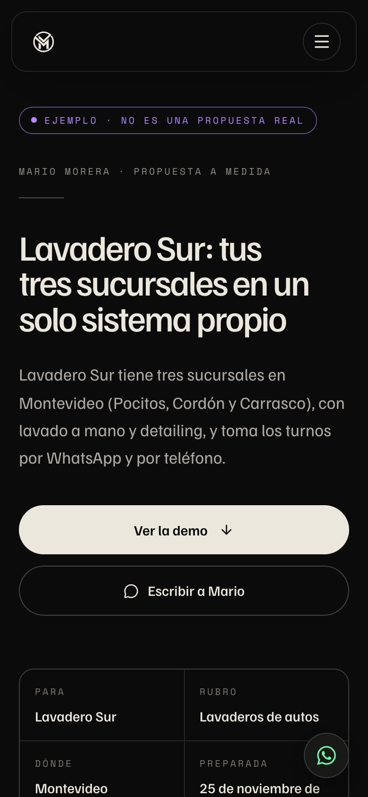

# Propuestas a medida: /p/<slug>

Una página por negocio u oportunidad: `https://mmorera.agency/p/<slug>`. La escribe Claude con el botón 📄 del bot de Telegram (tabla `propuestas` de la base `ventas`, ver `central/ventas/agentes.md`) y n8n la sirve.

## De dónde salen los datos

- `GET https://n8n.smorera.tech/webhook/propuesta?slug=<slug>` (workflow «Propuestas · Página»): 200 con el JSON si está publicada, 404 si no.
- La página la pide en el servidor y la guarda 5 minutos (ISR). Si n8n dice 404, muestra un aviso amable con salida a WhatsApp. Si n8n falla, sigue la copia guardada; si no había, un aviso para reintentar.
- `PROPUESTAS_WEBHOOK_URL` (opcional, solo servidor) apunta a otro n8n para probar.

## Qué muestra

En el idioma del JSON (`es` o `en`): portada con `titular`, `situacion` y ficha (negocio, rubro, lugar, fecha); 01 diagnóstico (1 a 3 hallazgos, con captura si hay); 02 la demo de su rubro (botón a `demo.url`, con `demo.imagen` si viene); 03 cómo quedaría (`como_quedaria`); 04 por qué un sistema propio (`por_que_propio`); 05 siguiente paso (`siguiente_paso.texto`, con WhatsApp y email si vienen; si no viene ninguno, el WhatsApp de Mario).

Los textos fijos van en infinitivo o con posesivos para servir con «vos» y con «tú».

## Reglas

- **Nunca precio (D-011).** Si algún texto trae una cifra con moneda («USD 500», «$ 1.200», «49/mes»…), la propuesta no se muestra (404) y queda `propuesta-descartada` en los registros de Vercel.
- Privada por enlace: `noindex, nofollow`, fuera del sitemap.
- Solo enlaces `https` (la imagen y las capturas también pueden ser del propio sitio, `/…`). WhatsApp solo `wa.me` o `api.whatsapp.com`. En `/p/:slug` la política de contenido acepta imágenes `https:` de otros dominios; en el resto del sitio, no.
- El repo es público: las propuestas reales no van acá.

## Ejemplo para desarrollo

`/p/ejemplo` muestra un negocio ficticio (Lavadero Sur) con el formato exacto (`src/data/propuestaEjemplo.ts`), marcado como ejemplo. Existe en `next dev` y en las vistas previas de Vercel; en producción da 404.

## Visitas

Ver `docs/demos/REGISTRO-DE-VISITAS.md` («Propuestas a medida»).

